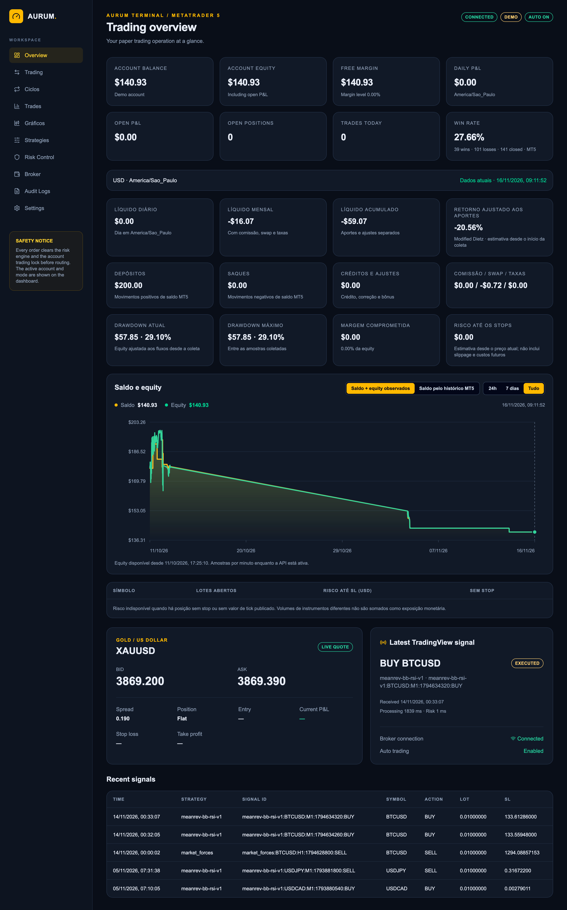
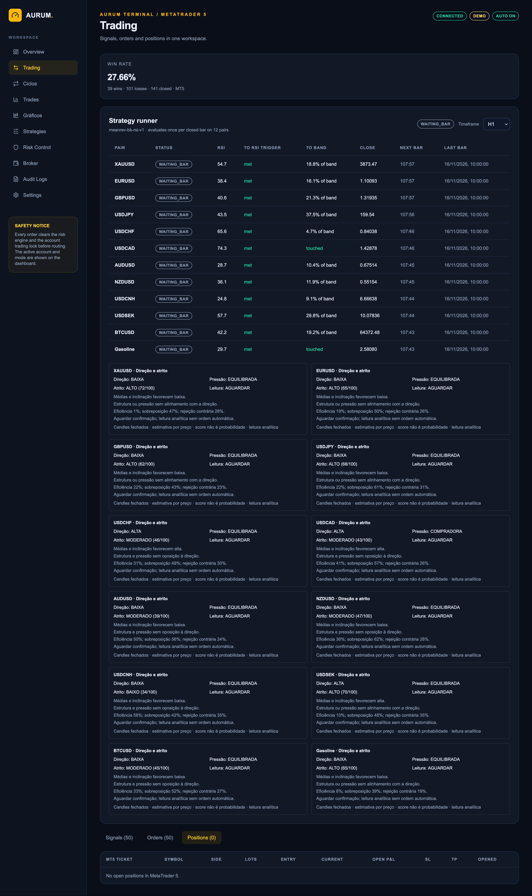
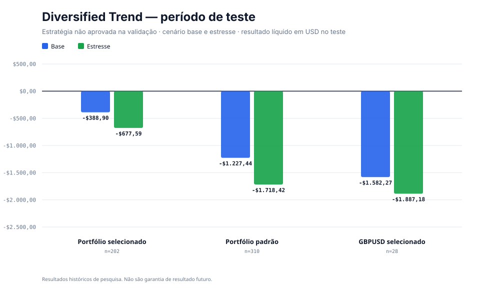

# Aurum Terminal

Bot de trading auto-hospedado para **MetaTrader 5**, com painel web em português, risk engine, backtests e auditoria. As estratégias decidem; o MT5 executa. Não há broker simulado: conta, preços, posições e ordens vêm sempre do terminal.

`MetaTrader 5 → ponte MQL5 → API Elysia → PostgreSQL → dashboard Next.js` — monorepo Bun/TypeScript.



## O que faz

- **Sinais** de estratégias embutidas ou de um webhook do TradingView.
- **Risk engine** com lote máximo, perda diária, limite de posições, stop obrigatório, sessões Forex, stop monetário e símbolos permitidos.
- **Execução no MT5** com `OrderCheck`, confirmação de posição, idempotência e auditoria.
- **Painel em tempo real** com saldo, equity, P&L, posições, trades, gráficos e drawdown.
- **Proteções**: Auto trading desligado por padrão, emergency stop e confirmação explícita para conta real.

## Telas

| Trading | Risk Control |
| --- | --- |
| <a href="docs/screenshots/02-trading.png"></a> | <a href="docs/screenshots/06-risk-control.png"></a> |

Veja todas as telas e o tour completo em [docs/reference.md](docs/reference.md).

## Backtest

Resultado líquido dos melhores candidatos por estratégia, com treino, holdout e um cenário de estresse com 1,5x o spread:


> Os resultados vêm de simulações de pesquisa com snapshots históricos, não de execução real no MT5. As amostras são pequenas e o holdout não deve ser reutilizado para escolher parâmetros. Não são garantia de resultado futuro.

Gere ou atualize os gráficos com:

```sh
bun run research:plot
```

<details>
<summary>Outros gráficos de backtest</summary>

**Mean reversal BB+RSI por timeframe** — parâmetros fixos, treino vs. holdout:


**Market Forces por timeframe** — cenário base e estresse:


**Diversified Trend no período de teste** — estratégia não aprovada na validação:



Relatórios completos: [estratégias clássicas](docs/reference.md#research-only-backtests), [mean reversion](reports/meanrev-timeframe-backtest-2026-11-04.json), [Market Forces](reports/market-forces-backtest-2026-11-13.md) e [Diversified Trend](reports/diversified-trend-optimization-2016-2025.md).

</details>

## Requisitos

- Bun 1.3+
- PostgreSQL 16
- MetaTrader 5 com o serviço `AurumBridge` (para dados e execução)
- Docker opcional

## Rodar localmente

No macOS, instale e inicie o PostgreSQL uma vez:

```sh
brew install postgresql@16
brew services start postgresql@16
export PATH="$(brew --prefix postgresql@16)/bin:$PATH"
```

Crie o banco (só na primeira vez):

```sh
psql -d postgres -c "CREATE ROLE trader WITH LOGIN PASSWORD 'trader';"
createdb -O trader tradingbot
```

Configure o ambiente e suba o projeto:

```sh
cp .env.example .env   # defina DASHBOARD_PASSWORD, ADMIN_API_KEY e TRADINGVIEW_WEBHOOK_SECRET
bun install
bun db:migrate
bun dev
```

- Dashboard: <http://localhost:3002>
- API: <http://localhost:3001/health>

O login do painel usa `DASHBOARD_USER` e `DASHBOARD_PASSWORD` do `.env`. Mantenha `AUTO_TRADING_ENABLED=false` até validar tudo.

## Conectar o MetaTrader 5

1. Compile e instale a ponte:

   ```sh
   bun run mt5:install
   ```

2. No MT5, faça login, habilite **Algo Trading** em Ferramentas → Opções e adicione `AurumBridge` em **Navigator → Services**.

   

   Ele precisa estar em **Services**. Se aparecer em Expert Advisors ou Scripts, remova e adicione novamente.

3. Verifique a conexão:

   ```sh
   bun run mt5:doctor
   ```

   O diagnóstico deve terminar com `bridge is ready`. O `/health` também informa conta, servidor e modo (demo/real).

Para rodar tudo com Docker, use `docker compose up --build` com as variáveis do `.env`.

## Primeiro uso

1. **Broker**: confirme `Connected` e a conta correta.
2. **Risk Control**: revise lote máximo, perda diária, sessões e símbolos permitidos. Deixe o Auto trading desligado.
3. **Trading**: confira se o strategy runner está avaliando os pares (não pode ficar `BLOCKED`).
4. Acompanhe sinais, ordens e posições em **Trading** e os resultados em **Trades**.
5. Só então habilite o **Auto trading**.

> Teste sempre em conta demo primeiro. O **EMERGENCY STOP** bloqueia novas ordens imediatamente, mas **não fecha** posições existentes.

## Estrutura

| Caminho | Responsabilidade |
| --- | --- |
| `apps/api` | Webhook, API, auditoria, SSE e orquestração. |
| `apps/web` | Dashboard Next.js. |
| `packages/trading` | Lote, risco, política de posições e envio de ordens. |
| `packages/strategy` | Indicadores e estratégias em TypeScript. |
| `packages/broker` | Adaptador da ponte MT5. |
| `packages/database` | Schema Drizzle e migrações SQL. |

## Comandos úteis

| Comando | O que faz |
| --- | --- |
| `bun dev` | Sobe API e dashboard em modo desenvolvimento. |
| `bun typecheck` | Verifica tipos de API e web. |
| `bun lint` | Roda o ESLint. |
| `bun test` | Roda os testes. |
| `bun run build` | Build de produção. |
| `bun run mt5:doctor` | Diagnostica a ponte MT5 sem enviar ordens. |
| `bun run mt5:install` | Compila e instala o `AurumBridge`. |
| `bun run research:strategies` | Backtests de pesquisa, sem conectar ao broker. |

## Documentação

- [Referência técnica completa](docs/reference.md) — arquitetura, risco, sessões, bridge, limitações e operação.
- [TradingView](docs/tradingview.md) — formato do webhook e exemplo em Pine Script.
- [Estratégias](docs/) — SMA Micro Trend, Dow Theory, Market Forces e outras.
