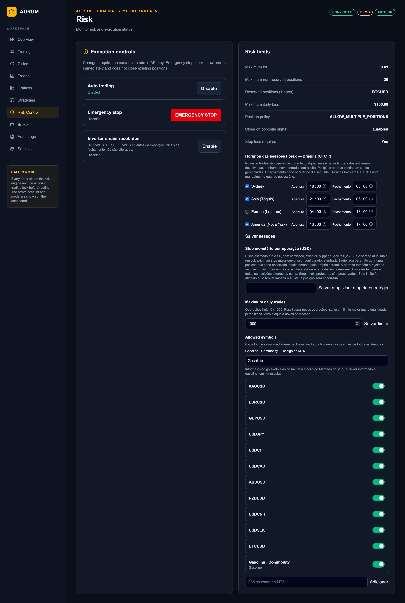
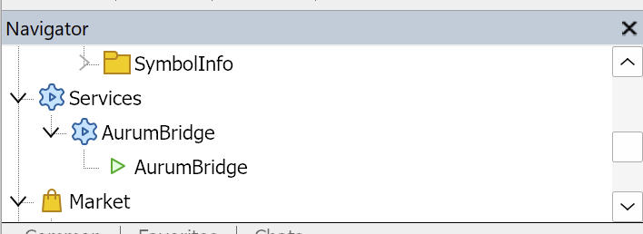
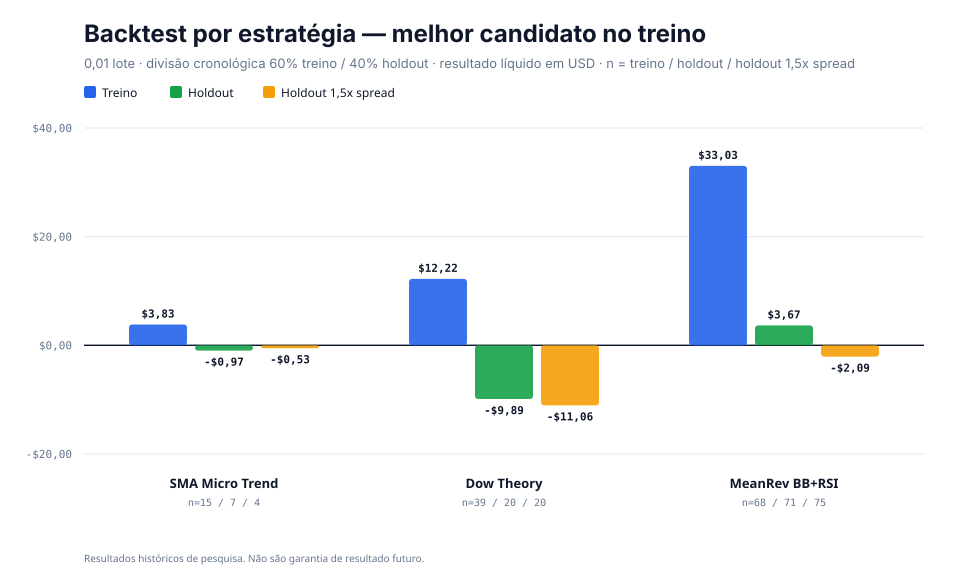
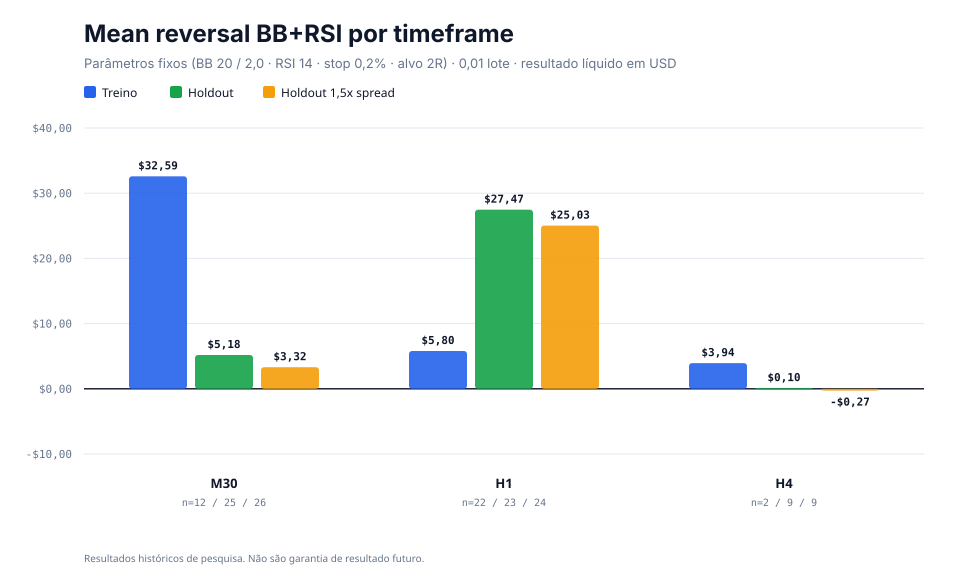
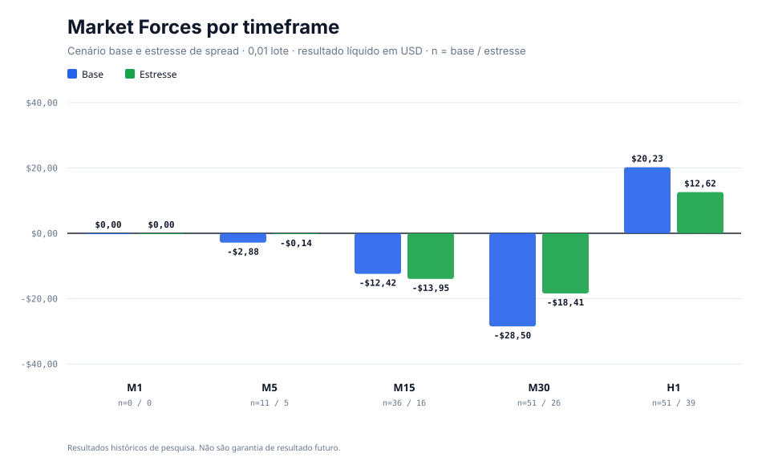

# Aurum Terminal

Bot de trading auto-hospedado para **MetaTrader 5**, com API em TypeScript, painel web em português, risk engine, backtests e auditoria. As estratégias decidem; o MT5 executa. Não existe broker simulado: conta, preços, posições e ordens vêm sempre do terminal.

```text
MetaTrader 5 → ponte MQL5 (AurumBridge) → API Elysia → PostgreSQL → dashboard Next.js
```

Monorepo Bun/TypeScript. O mesmo painel pode rodar no navegador ou em um app desktop macOS.


## Download (macOS)

[**Baixar TradingBot para macOS (Apple Silicon, arm64)**](https://github.com/BrunoFerreira995/tradingbot/raw/main/apps/desktop/releases/TradingBot_0.1.1_aarch64.dmg) — DMG de 3,4 MB.

> Build não assinado. O app abre o dashboard em `http://localhost:3002`, então a API e o painel precisam estar rodando localmente. Para distribuir fora do próprio Mac, é necessário assinar e notarizar com a Apple.

## Principais recursos

- **Execução real no MT5** com `OrderCheck`, confirmação de posição, idempotência por `signalId` e prevenção de ordens duplicadas.
- **Risk engine** com lote máximo, limite de posições, perda e meta de lucro diárias, limite de trades por dia, stop obrigatório, sessões Forex, símbolos permitidos e stop monetário por operação ou por símbolo.
- **Estratégias embutidas** executadas pelo strategy runner no fechamento da vela, além de sinais externos via webhook do TradingView.
- **Painel em tempo real** com saldo, equity, margem, P&L, posições, sinais, ordens, trades, gráficos de candles e drawdown.
- **Auditoria e exportação** de trades e sessões do bot em CSV.
- **Proteções de segurança**: Auto trading desligado por padrão, emergency stop, confirmação explícita para conta real, autenticação básica no dashboard e admin key entre web e API.
- **Operação local simplificada**: scripts para instalar/diagnosticar a ponte MT5, rodar com PM2 e gerar o app desktop macOS.

## Telas

| Trading                                                                                                             | Risk Control                                                                                                                       |
| ------------------------------------------------------------------------------------------------------------------- | ---------------------------------------------------------------------------------------------------------------------------------- |
| <a href="docs/screenshots/02-trading.png"></a> | <a href="docs/screenshots/06-risk-control.png"></a> |

O menu reúne as áreas operacionais: **Overview**, **Trading**, **Ciclos**, **Trades**, **Gráficos**, **Strategies**, **Risk Control**, **Broker** e **Audit Logs**. As configurações de risco ficam em **Risk Control**.

Veja todas as telas e o tour completo em [docs/reference.md](docs/reference.md).

## Arquitetura

| Camada              | Responsabilidade                                                                       |
| ------------------- | -------------------------------------------------------------------------------------- |
| `apps/desktop`      | App Tauri para macOS que abre o dashboard local em uma janela nativa.                  |
| `apps/web`          | Dashboard Next.js, proxy autenticado para a API, SSE e controles operacionais.         |
| `apps/api`          | Webhook, API, strategy runner, auditoria, SSE, health check e orquestração das ordens. |
| `packages/trading`  | Lote, risco, política de posições, stops e envio de ordens.                            |
| `packages/strategy` | Indicadores e estratégias em TypeScript.                                               |
| `packages/broker`   | Adaptador da ponte MT5 e serviço MQL5 `AurumBridge`.                                   |
| `packages/database` | Schema Drizzle, migrações SQL e persistência.                                          |

Fluxo de uma operação:

1. O strategy runner avalia as velas fechadas ou um webhook aceita um sinal autenticado.
2. A API grava o sinal com um `signalId` único e serializa o processamento por conta.
3. O risk engine aplica todos os limites configurados.
4. O adaptador envia a ordem pela ponte de arquivos para o MT5.
5. O MT5 executa e publica conta, posições, ordens e resultados.
6. O dashboard recebe os dados por polling e SSE, e a operação fica registrada na auditoria.

A API pode iniciar sem o MT5 conectado, mas dados de conta, preços e execução só existem quando o serviço `AurumBridge` está ativo no terminal.

## Requisitos

- **Bun 1.3+**
- **PostgreSQL 16**
- **MetaTrader 5** com o serviço `AurumBridge` para dados e execução
- **macOS** para a ponte MT5 via Wine e para o app desktop
- **Docker** e **Docker Compose** opcionais
- **Rust** e Xcode Command Line Tools apenas para compilar o app desktop

## Início rápido (macOS local)

Instale e inicie o PostgreSQL uma vez:

```sh
brew install postgresql@16
brew services start postgresql@16
export PATH="$(brew --prefix postgresql@16)/bin:$PATH"
```

Crie o banco (só na primeira vez):

```sh
psql -d postgres -c "CREATE ROLE trader WITH LOGIN PASSWORD 'trader';"
createdb -O trader tradingbot
```

Configure o ambiente e suba o projeto:

```sh
cp .env.example .env
# edite DASHBOARD_PASSWORD, ADMIN_API_KEY e TRADINGVIEW_WEBHOOK_SECRET
bun install
bun db:migrate
bun dev
```

- Dashboard: <http://localhost:3002>
- API: <http://localhost:3001/health>

O login do painel usa `DASHBOARD_USER` e `DASHBOARD_PASSWORD`. Mantenha `AUTO_TRADING_ENABLED=false` até validar tudo. Configurações de risco já salvas no PostgreSQL prevalecem sobre o valor inicial do `.env`, então confirme o estado no dashboard.

## Produção local com PM2

Para rodar API e dashboard como serviços:

```sh
bun run build
bun run pm2:start
bun run pm2:logs
```

Depois de alterar código ou variáveis de ambiente:

```sh
bun run build
bun run pm2:restart
pm2 save
```

No PM2, a API usa a porta `3001` e o dashboard usa `3002`. O arquivo de configuração é [ecosystem.config.cjs](ecosystem.config.cjs).

## Docker (opcional)

Para subir tudo em containers:

```sh
bun install
docker compose up --build
```

O Compose inclui PostgreSQL, API e dashboard, e a API aplica as migrações na inicialização.

Para conectar o MT5 a partir do Docker, monte a pasta `Common\Files` do terminal no container:

```sh
MT5_HOST_BRIDGE_DIR="$HOME/Library/Application Support/net.metaquotes.wine.metatrader5/drive_c/users/user/AppData/Roaming/MetaQuotes/Terminal/Common/Files" \
  docker compose -f docker-compose.yml -f docker-compose.mt5.yml up -d
```

O arquivo [docker-compose.mt5.yml](docker-compose.mt5.yml) monta essa pasta em `/bridge` e define `MT5_BRIDGE_DIR=/bridge` na API.

## Conectar o MetaTrader 5

1. Compile e instale a ponte:

   ```sh
   bun run mt5:install
   ```

2. No MT5, faça login, habilite **Algo Trading** em **Ferramentas → Opções → Expert Advisors** e adicione `AurumBridge` em **Navigator → Services**.

   

   Ele precisa estar em **Services**. Se aparecer em Expert Advisors ou Scripts, remova e adicione novamente.

3. Verifique a conexão pela linha de comando:

   ```sh
   bun run mt5:doctor
   ```

   O diagnóstico deve terminar com `bridge is ready`. Ele verifica a pasta da ponte, o serviço, o heartbeat, a conta, a permissão de trading, a watch list, as posições abertas e a fila de comandos, sem enviar ordens.

4. A mesma instalação e o mesmo diagnóstico estão disponíveis no painel: abra **Broker** e use os botões **Instalar / atualizar bridge** e **Diagnosticar conexão**. A saída do comando aparece na própria tela.

Se a watch list acusar símbolo ausente, confira se o código existe na **Observação do Mercado** do MT5. Nomes como `Gasoline` diferenciam maiúsculas e minúsculas, e o diagnóstico já compara os símbolos sem diferenciar caixa.

## Configuração

As variáveis completas estão em [.env.example](.env.example). As principais:

| Variável                                                 | Para que serve                                                                         |
| -------------------------------------------------------- | -------------------------------------------------------------------------------------- |
| `DATABASE_URL`                                           | Conexão PostgreSQL.                                                                    |
| `ADMIN_API_KEY`                                          | Chave server-side entre dashboard e API; nunca vai para o navegador.                   |
| `DASHBOARD_USER` / `DASHBOARD_PASSWORD`                  | Autenticação HTTP Basic do dashboard.                                                  |
| `TRADINGVIEW_WEBHOOK_SECRET` / `TRADINGVIEW_HMAC_SECRET` | Autenticação dos webhooks do TradingView.                                              |
| `TRADING_MODE`                                           | `auto`, `paper` ou `live`. Em `auto`, o modo é detectado pelo heartbeat do MT5.        |
| `AUTO_TRADING_ENABLED`                                   | Valor inicial do Auto trading; o dashboard tem precedência após o primeiro salvamento. |
| `MT5_BRIDGE_DIR`                                         | Pasta `Common\Files` da ponte vista pelo processo da API.                              |
| `MT5_HOST_BRIDGE_DIR`                                    | Caminho no host usado pelo Compose para montar a ponte no container.                   |
| `MT5_PRIMARY_SYMBOL` / `MT5_SYMBOLS`                     | Símbolo principal e lista de símbolos avaliados e negociados.                          |
| `MT5_MAGIC`                                              | Magic number das ordens enviadas pelo bot.                                             |
| `MT5_LIVE_ACK`                                           | Confirmação do login da conta real; obrigatório para operar em live.                   |
| `MT5_RECONNECT_MS`                                       | Intervalo de nova tentativa enquanto o terminal está desconectado.                     |
| `STRATEGY_RUNNER` / `STRATEGY_TIMEFRAME`                 | Estratégia embutida e timeframe avaliados no fechamento da vela.                       |
| `MAX_LOT_SIZE` / `MAX_OPEN_POSITIONS`                    | Lote máximo e limite de posições abertas.                                              |
| `RESERVED_POSITION_SYMBOLS`                              | Símbolos com uma posição adicional fora do limite comum.                               |
| `MAX_DAILY_LOSS` / `MAX_DAILY_PROFIT`                    | Perda máxima e meta opcional de lucro diário na moeda da conta.                        |
| `MAX_DAILY_TRADES`                                       | Limite de operações novas por dia.                                                     |
| `CLOSE_ON_OPPOSITE_SIGNAL`                               | Fecha a posição oposta em vez de abrir uma nova.                                       |
| `WEB_ORIGIN`                                             | Origem permitida para CORS e SSE.                                                      |
| `REPORT_TIMEZONE`                                        | Fuso dos relatórios diários e mensais.                                                 |

## Uso diário

1. **Broker**: confirme `Connected`, a conta e o modo demo/real.
2. **Risk Control**: revise lote máximo, perda e meta diária, limite de trades, sessões, stop monetário e símbolos permitidos. Deixe o Auto trading desligado.
3. **Trading**: confira se o strategy runner está avaliando os pares e não está `BLOCKED`.
4. Acompanhe sinais, ordens e posições em **Trading** e os resultados em **Trades** e **Overview**.
5. Só então habilite o **Auto trading**.

> Teste sempre em conta demo primeiro. O **EMERGENCY STOP** bloqueia novas ordens imediatamente, mas **não fecha** posições existentes.

### Regras de risco

O risk engine bloqueia novas entradas quando qualquer limite é atingido:

- lote acima de `MAX_LOT_SIZE`;
- posições abertas acima de `MAX_OPEN_POSITIONS`, com exceção dos símbolos reservados;
- perda realizada no dia maior ou igual a `MAX_DAILY_LOSS`;
- lucro realizado no dia maior ou igual a `MAX_DAILY_PROFIT`, quando configurado;
- trades novos acima de `MAX_DAILY_TRADES`;
- símbolo fora de `allowedSymbols` ou fora das sessões habilitadas;
- ordem sem stop quando `requireStopLoss` está ativo;
- stop monetário por operação ou por símbolo violado.

Ao atingir a meta de lucro diária, novas entradas são bloqueadas até o próximo dia; posições abertas continuam com seus próprios stops e take profits.

## Estratégias e backtests

O runner padrão é `meanrev-bb-rsi-v1` no timeframe definido por `STRATEGY_TIMEFRAME`. Outras estratégias de pesquisa e seus relatórios estão em [docs](docs/) e `reports/`.

Resultado líquido dos melhores candidatos por estratégia, com treino, holdout e cenário de estresse com 1,5x o spread:



**Resumo:**

- **Melhor retorno total: MeanRev BB+RSI no M30** — US$ 37,77 no backtest de timeframes (treino + holdout) e US$ 36,70 no melhor candidato por treino.
- **Melhor holdout isolado: BB+RSI no H1** — US$ 27,47, contra US$ 5,18 do M30.
- O M30 concentra o ganho no treino (US$ 32,59) e cai no holdout; o H1 faz o contrário.

> Os resultados vêm de simulações de pesquisa com snapshots históricos, não de execução real no MT5. As amostras são pequenas e o holdout não deve ser reutilizado para escolher parâmetros. Não são garantia de resultado futuro.

Gere ou atualize os gráficos com:

```sh
bun run research:plot
```

<details>
<summary>Outros gráficos de backtest</summary>

**Mean reversal BB+RSI por timeframe** — parâmetros fixos, treino vs. holdout:



**Market Forces por timeframe** — cenário base e estresse:



**Diversified Trend no período de teste** — estratégia não aprovada na validação:


Relatórios completos: [estratégias clássicas](docs/reference.md#research-only-backtests), [mean reversion](reports/meanrev-timeframe-backtest-2026-11-04.json), [Market Forces](reports/market-forces-backtest-2026-11-13.md) e [Diversified Trend](reports/diversified-trend-optimization-2016-2025.md).

</details>

## TradingView

O webhook aceita o segredo no JSON, no header `X-Webhook-Secret` ou em headers HMAC com timestamp. Cada sinal precisa de um `signalId` único.

```sh
curl -X POST http://localhost:3001/api/webhooks/tradingview \
  -H 'content-type: application/json' \
  -d '{"secret":"YOUR_SECRET","strategy":"gold-scalping-v1","signalId":"manual-001","symbol":"XAUUSD","action":"BUY","orderType":"MARKET","lots":0.01,"stopLoss":25,"takeProfit":50}'
```

Em desenvolvimento, `POST /api/test/signal` aceita `{ "action": "BUY" }`, `{ "action": "SELL" }` ou `{ "action": "CLOSE" }`. Ele não existe em produção.

Detalhes do formato e um exemplo em Pine Script: [docs/tradingview.md](docs/tradingview.md).

## App desktop (macOS)

O app Tauri apenas abre o dashboard local em uma janela nativa. Ele não embute API nem banco.

```sh
bun run desktop:dev
bun run desktop:build:mac
```

O build gera `.app` e `.dmg` em `apps/desktop/src-tauri/target/release/bundle/` e copia o DMG para [apps/desktop/releases](apps/desktop/releases). A versão atual é **0.1.1**.

## Estrutura do monorepo

| Caminho             | Conteúdo                                                     |
| ------------------- | ------------------------------------------------------------ |
| `apps/api`          | API Elysia, strategy runner, webhook, auditoria e SSE.       |
| `apps/web`          | Dashboard Next.js e proxies autenticados.                    |
| `apps/desktop`      | App Tauri, ícones e script de build macOS.                   |
| `packages/broker`   | Ponte MT5, serviço MQL5 e scripts de instalação/diagnóstico. |
| `packages/database` | Schema Drizzle e migrações.                                  |
| `packages/strategy` | Indicadores, estratégias e backtests em TypeScript.          |
| `packages/trading`  | Risk engine, dimensionamento e execução.                     |
| `packages/shared`   | Tipos e utilitários compartilhados.                          |
| `docs`              | Referência técnica, estratégias, TradingView e screenshots.  |
| `reports`           | Backtests e análises de pesquisa.                            |

## Comandos úteis

| Comando                       | O que faz                                          |
| ----------------------------- | -------------------------------------------------- |
| `bun dev`                     | Sobe API e dashboard em desenvolvimento.           |
| `bun run build`               | Build de produção da web e da API.                 |
| `bun run typecheck`           | Verifica tipos de API e web.                       |
| `bun run lint`                | Roda o ESLint.                                     |
| `bun test`                    | Roda os testes.                                    |
| `bun run db:migrate`          | Aplica as migrações no PostgreSQL.                 |
| `bun run db:generate`         | Gera uma nova migração Drizzle.                    |
| `bun run mt5:install`         | Compila e instala o `AurumBridge` no MT5.          |
| `bun run mt5:build`           | Apenas compila o serviço MQL5.                     |
| `bun run mt5:doctor`          | Diagnostica a ponte sem enviar ordens.             |
| `bun run pm2:start`           | Inicia API e dashboard no PM2.                     |
| `bun run pm2:restart`         | Reinicia os processos do PM2 com o ambiente atual. |
| `bun run pm2:logs`            | Mostra os logs da API e do dashboard.              |
| `bun run pm2:stop`            | Remove os processos do PM2.                        |
| `bun run desktop:dev`         | Abre o app desktop em modo desenvolvimento.        |
| `bun run desktop:build:mac`   | Gera `.app` e `.dmg` para macOS.                   |
| `bun run research:strategies` | Roda os backtests de pesquisa.                     |
| `bun run research:plot`       | Gera os gráficos de backtest.                      |

## Qualidade e operação

Antes de publicar ou alterar a lógica de execução:

```sh
bun test
bun run typecheck
bun run lint
bun run build
```

Boas práticas:

- mantenha `AUTO_TRADING_ENABLED=false` e o auto trading desligado no dashboard até validar a conexão e os sinais;
- use uma conta demo até o fluxo inteiro estar estável;
- faça backup do PostgreSQL e guarde os segredos apenas no `.env` local;
- monitore `GET /health` e os logs do PM2 ou do Docker;
- se o dashboard ou a API reiniciarem, confirme se o heartbeat do MT5 continua atualizado;
- nunca reutilize o holdout de pesquisa para escolher parâmetros em produção.

## Segurança

- O dashboard usa HTTP Basic em produção.
- O navegador nunca recebe `ADMIN_API_KEY`; o proxy do Next injeta a chave no servidor.
- Webhooks exigem segredo ou HMAC e `signalId` único.
- Ordens são idempotentes e o processamento por conta usa lock no PostgreSQL.
- Conta real exige `MT5_LIVE_ACK` igual ao login conectado.
- Emergency stop bloqueia novas ordens, mas não fecha posições existentes.
- O app desktop e o DMG atual não são assinados nem notarizados.

## Documentação

- [Referência técnica completa](docs/reference.md) — arquitetura, risco, sessões, bridge, limitações e operação.
- [TradingView](docs/tradingview.md) — formato do webhook e exemplo em Pine Script.
- [Estratégias](docs/) — SMA Micro Trend, Dow Theory, Market Forces, Force Shock, Diversified Trend e outras.

## Aviso

Trading envolve risco de perda. Este projeto é uma ferramenta de automação e pesquisa, não uma recomendação de investimento. Valide tudo em conta demo e use apenas capital que você pode perder.
